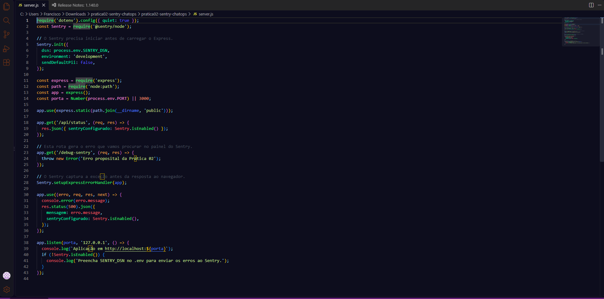
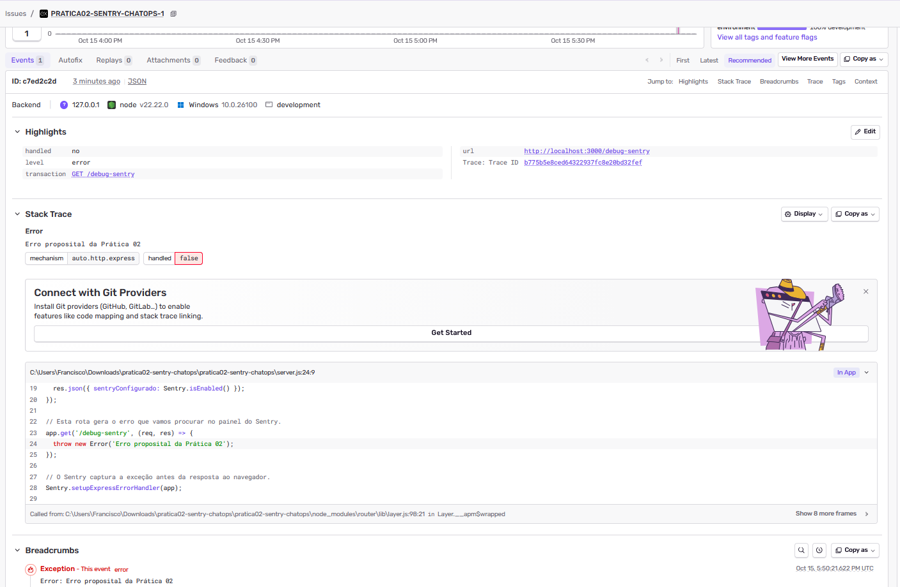
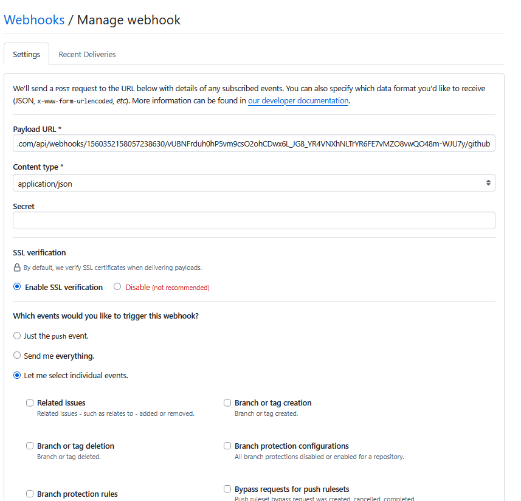

# Prática 02 - Sentry e ChatOps

**Aluno:** Francisco de Assis Vieira Filho  
**Curso:** Análise e Desenvolvimento de Sistemas - IFCE Campus Boa Viagem  
**Disciplina:** Programação Web II  
**Professor:** Wesnei de Paiva Batista

O projeto é um teste simples de monitoramento de erros. A aplicação tem um botão que chama a rota `/debug-sentry` e gera uma exceção proposital. O Sentry registra esse erro e mostra o caminho do código até o ponto onde ele aconteceu.

A outra parte da prática liga o repositório do GitHub a um canal do Discord. Assim, os eventos selecionados no webhook geram notificações no canal.

## Ferramentas utilizadas

- Node.js e Express para o servidor.
- HTML, CSS e JavaScript para a tela.
- SDK `@sentry/node` para a integração com o Sentry.
- GitHub, Git e webhook do Discord para as notificações.

## Como executar

É necessário ter o Node.js 22 ou superior instalado.

1. Instale as dependências na pasta do projeto:

   ```powershell
   npm ci
   ```

2. Na primeira execução, crie o arquivo `.env` a partir do exemplo:

   ```powershell
   Copy-Item .env.example .env
   ```

3. No `.env`, preencha `SENTRY_DSN` com a DSN do seu projeto no Sentry e mantenha `PORT=3000`.
4. Inicie a aplicação:

   ```powershell
   npm start
   ```

5. Abra <http://localhost:3000> e clique em **Gerar erro de teste**.
6. No painel do Sentry, abra **Issues** e procure `Erro proposital da Prática 02`.

O retorno HTTP 500 é esperado nesse teste. Ele ocorre porque a rota lança a exceção de propósito. O servidor continua atendendo outras requisições. Se alterar a DSN, reinicie a aplicação para carregar a configuração atualizada.

## Como funciona a captura do erro

O `server.js` carrega as configurações do `.env` e inicia o Sentry antes do Express. A rota `/debug-sentry` executa `throw new Error(...)`. O Sentry captura a exceção, e o tratamento final do servidor devolve uma resposta JSON com status 500.

A confirmação da captura é feita no painel do Sentry, onde o stack trace mostra o arquivo `server.js` e a linha que gerou o erro.

## Integração com o Discord

O webhook foi criado no Discord e cadastrado em **Settings > Webhooks** no GitHub. A URL usa o final `/github`, com o tipo de conteúdo `application/json` e os eventos **Pushes** e **Pull requests** selecionados.

Quando os commits são enviados com `git push`, o GitHub envia o evento ao webhook, e a notificação aparece no canal do Discord.

## Evidências da execução

### Print 1 - Código da aplicação

Inicialização do Sentry e rota `/debug-sentry` com o erro proposital.



### Print 2 - Erro capturado no Sentry

O erro aparece no painel com o stack trace e a referência à linha 24 do `server.js`.



### Print 3 - Webhook configurado no GitHub

Configuração do webhook para enviar os eventos do repositório ao Discord. O token da URL foi ocultado no print.



### Print 4 - Notificação recebida no Discord

Mensagem automática recebida após o push do commit `0cee5a5`, que adicionou a aplicação de teste com Sentry.


## Referências

- [Sentry para Express](https://docs.sentry.io/platforms/javascript/guides/express/)
- [Webhooks no GitHub](https://docs.github.com/en/webhooks/using-webhooks/creating-webhooks)
- [Webhooks no Discord](https://support.discord.com/hc/en-us/articles/228383668-Intro-to-Webhooks)
